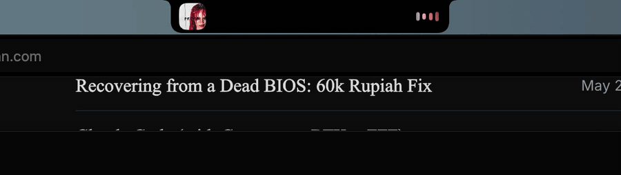

# niche

a dynamic island for the mac notch.



## features

- now playing: artwork, title, seek bar, controls, waveform bars
- live visualizer (optional): bars follow the playing app's audio
- agents: live claude code and omp sessions, working or paused
- click a session to jump to its tmux pane and terminal tab
- feature switcher: flip between music and agents
- lock screen padlock that springs open on unlock
- settings with a pane per feature
- updates from github releases, with what changed

## build

```sh
./build.sh
```

makes `build/Niche.app` and `build/Niche.dmg`. macos 15+.

## credits

- [mediaremote-adapter](https://github.com/ungive/mediaremote-adapter) (bsd-3) for now playing
