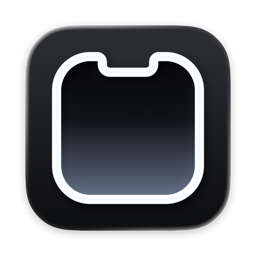
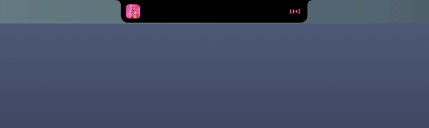

<div align="center">



# niche

**your mac's notch, finally doing something.**

music, your ai agents and little system moments, living right where the camera is.

[**download for mac**](https://github.com/raihanadf/niche/releases/latest/download/Niche.dmg) · [website](https://niche.iblameraihan.com) · [what's new](CHANGELOG.md)

<sub>free · macos 15 or later · macbooks with a notch</sub>

<br>



</div>

## hover to peek

move your pointer to the notch and it opens. move away and it tucks itself back in.

- **music**: artwork, title, a seek bar and playback controls for whatever is playing. the little bars dance along with it.
- **ai agents**: see your claude code and omp sessions at a glance, working or waiting. click one to jump straight to its terminal.
- **clipboard**: your last 10 copies as tiles in the notch. press ⌃⌘V anywhere and hit a number to paste one.
- **notch picture**: pin a picture or gif to the empty notch. it stays when only agents are running.
- **one tap to switch**: flip between music and agents with the switcher in the corner.

## little moments, in the notch


volume, brightness, caps lock, focus, charging, low battery and finished agents show up as a quick glance in the notch, then step aside. niche can replace the big system volume and brightness popups, so nothing covers your screen.

## a lock that clicks


a padlock sits by the notch on the lock screen and springs open when you're back.

## install

1. [download niche.dmg](https://github.com/raihanadf/niche/releases/latest/download/Niche.dmg) and drag **niche** into **applications**.
2. open it. a short welcome asks for two things, both optional:
   - **accessibility**, so niche can replace the volume and brightness popups and open the right terminal tab.
   - **open at login**, so the notch is ready every time.

> **mac says it can't check niche?** niche isn't notarized by apple yet. open **system settings → privacy & security**, scroll down and click **open anyway**. you only need to do this once.

niche updates itself: when a new version is out, it shows up in settings with what changed, and installs in one click.

## private by design

niche runs entirely on your mac. it has no account, no analytics and sends nothing anywhere; the only thing it asks the internet is whether a new version is out.

## settings

right-click the notch, or use the menu bar icon, to open settings. every feature and every little moment can be turned off on its own.

<details>
<summary><b>for developers</b></summary>

<br>

```sh
./build.sh
```

makes `build/Niche.app` and `build/Niche.dmg`. needs xcode command line tools on macos 15 or later.

</details>

## thanks

- [mediaremote-adapter](https://github.com/ungive/mediaremote-adapter) (bsd-3), which powers now playing.
